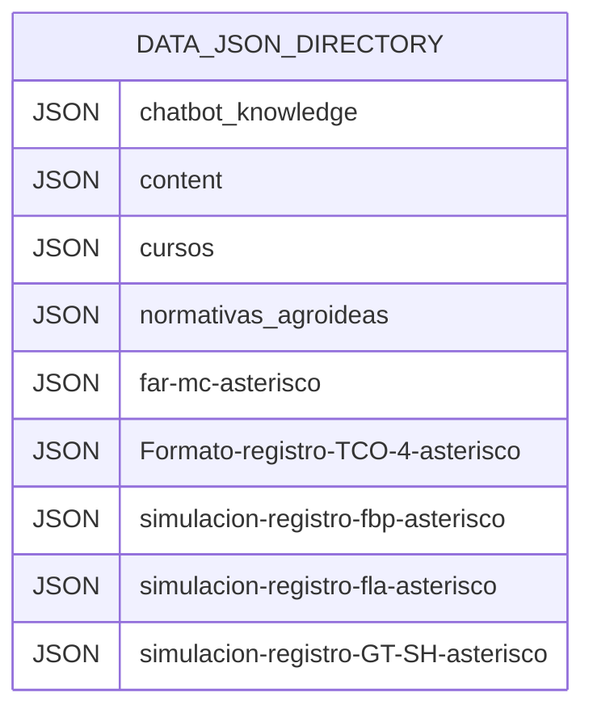

# DISEÑO DE REQUERIMIENTO
**<<OFICINA GENERAL DE TECNOLOGÍA DE LA INFORMACIÓN O QUIEN HAGA SUS VECES>>**

---

## 1. DATOS DEL PROYECTO

| Campo | Descripción |
|---|---|
| **Código del proyecto** | PWM-AGROIDEAS (Artefacto MCVS-204) |
| **Nombre** | Portal Web de Modernización de la Gestión Pública y Repositorio Central de AGROIDEAS (PWM-AGROIDEAS) |
| **Responsable** | Unidad de Planeamiento y Presupuesto (UPP) |
| **Fecha de actualización** | 10 de Octubre de 2026 |

---

## 2. MODELO DE DATOS

Dado que el portal se encuentra implementado mediante una arquitectura estática (Client-Side Rendering), el modelo de datos no emplea un motor de base de datos relacional tradicional (SQL). Se fundamenta en un modelo **orientado a documentos** a través de archivos estructurados en formato `JSON` almacenados localmente en la carpeta `/data`.

### 2.1. Modelo Conceptual

```mermaid
classDiagram
    class ChatbotKnowledge {
        +Object metadata
        +Array categories
        +Array knowledge_nodes
    }
    class Content {
        +Array sections
    }
    class Cursos {
        +Array modulos
    }
    class FichaMicrocurso {
        +Object NavegacionYTrazabilidad
        +Object MetadatosFicha
    }
    class FormatoTCO {
        +String Link
        +Object DatosGeneralesPuesto
        +Object ConocimientoOrganizacionalCritico
    }
    class Normativas {
        +String titulo
        +String resolucion_aprobatoria
        +String enlace
    }
    class FichaBuenaPractica {
        +Object MetadatosTrazabilidad
        +Object JustificacionDiagnostico
        +Object DesarrolloExperiencia
        +Object EvidenciasDocumentacion
        +Array ValidacionCalidad
    }
    class FichaLeccionAprendida {
        +Object MetadatosTrazabilidad
        +Object DescripcionIncidente
        +Object AccionMitigadora
        +Object LeccionAprendida
        +Array ValidacionCalidad
    }
    class GuiaTecnica {
        +Object MetadatosTrazabilidad
        +Object PropositoValorPublico
        +Object DesarrolloTecnicoPasoAPaso
        +Object ToqueExpertoTacito
        +Object RecursosSostenibilidad
    }
```



### 2.2. Modelo Físico



---

## 3. DICCIONARIO DE DATOS

### 3.1. Lista de Tablas (Colecciones JSON implementadas)

| Nombre de Tabla / Colección | Descripción |
|---|---|
| **chatbot_knowledge.json** | Almacena el corpus normativo del SAMGP y los nodos de conocimiento para el asistente virtual. |
| **content.json** | Define las secciones estáticas del sitio (ej. definición, fases, roles). |
| **cursos.json** | Contiene el catálogo de módulos de inducción, subtemas y preguntas de evaluación. |
| **far-mc-*.json** | Almacena las Fichas de Aprendizaje Rápido (Micro-Cursos), incluyendo su navegación y metadatos. |
| **Formato-registro-TCO-4-*.json** | Registros de Transferencia de Conocimiento Organizacional (datos del puesto y conocimientos críticos). |
| **normativas_agroideas.json** | Directorio de normativas y resoluciones de Agroideas publicadas. |
| **simulacion-registro-fbp-*.json**| Fichas de Buenas Prácticas; registra justificación, diagnóstico y desarrollo de una mejora replicable. |
| **simulacion-registro-fla-*.json**| Fichas de Lecciones Aprendidas; documenta desviaciones o incidentes, acciones mitigadoras y la lección extraída. |
| **simulacion-registro-GT-SH-*.json**| Guías Técnicas del "Saber Hacer"; documenta el proceso paso a paso, toque experto y valor público de una tarea crítica. |

### 3.2. Estructura de Tablas (Esquemas JSON)

*(Se documentan exclusivamente las colecciones verificadas en la carpeta /data).*

**Nombre de la Tabla: simulacion-registro-fbp-*.json**
**Descripción:** Repositorio de Fichas de Buenas Prácticas (FBP).
| Campo | Descripción | Tipo de dato |
|---|---|---|
| MetadatosTrazabilidad | Datos base (código, título, autores, vinculación) | Object |
| JustificacionDiagnostico | Problema detectado y explicación de la idea innovadora | Object |
| DesarrolloExperiencia | Ejecución paso a paso, actores y obstáculos mitigados | Object |
| EvidenciasDocumentacion | Enlaces a repositorio que sustente la eficacia | Object |
| ValidacionCalidad | Criterios de validación institucional sobre la práctica | Array[Object] |

**Nombre de la Tabla: simulacion-registro-fla-*.json**
**Descripción:** Repositorio de Fichas de Lecciones Aprendidas (FLA).
| Campo | Descripción | Tipo de dato |
|---|---|---|
| MetadatosTrazabilidad | Título, proceso misional vinculado y autoría | Object |
| DescripcionIncidente | Hito del problema, descripción de la desviación y causa raíz | Object |
| AccionMitigadora | Procedimiento de solución y su impacto estimado | Object |
| LeccionAprendida | Síntesis de la lección y recomendaciones operativas | Object |
| ValidacionCalidad | Criterios de evaluación de eficacia y aplicabilidad | Array[Object] |

**Nombre de la Tabla: simulacion-registro-GT-SH-*.json**
**Descripción:** Guías Técnicas operativas ("Saber Hacer").
| Campo | Descripción | Tipo de dato |
|---|---|---|
| MetadatosTrazabilidad | Título, origen y vinculación de la guía técnica | Object |
| PropositoValorPublico | Objetivo, brecha a resolver y valor público generado | Object |
| DesarrolloTecnicoPasoAPaso| Instrucciones de ejecución, preparación y criterios de éxito | Object |
| ToqueExpertoTácito | Alertas, atajos operativos y manejo de imprevistos | Object |
| RecursosSostenibilidad | Necesidades o habilitadores de uso (costo cero, herramientas) | Object |

**(Nota: Las estructuras correspondientes a chatbot, content, cursos, far-mc, normativas y TCO fueron revisadas y se encuentran bajo este mismo patrón JSON estructural en el sistema de archivos).**

---

## 4. DIAGRAMA DE ARQUITECTURA DE SOFTWARE

```mermaid
graph TD
    subgraph "Capa de Presentación (Frontend / HTML)"
        V1[Vistas Estáticas HTML\nindex, repositorio, contacto]
        V2[Librerías Externas\nTailwind CSS, DataTables, AOS]
    end

    subgraph "Capa de Lógica y Control (Controladores JS)"
        C1[Controladores Principales\ncontent-loader.js, directivas-table.js]
        C2[Controladores de Detalle\ndetalle_buena_practica.js, detalle_guia_tecnica.js, etc.]
        C3[Motores Especializados\nchatbot-engine.js]
    end

    subgraph "Capa de Datos (Modelos JSON - /data)"
        M1[(Colecciones de Repositorio\n*.json)]
        M2[(Corpus del Chatbot\nchatbot_knowledge.json)]
    end

    V1 <-->|Manipulación del DOM / Eventos| C1
    V1 <-->|Manipulación del DOM / Eventos| C2
    V1 <-->|Interfaz de Chat| C3
    
    C1 -->|Fetch API (Asíncrono)| M1
    C2 -->|Fetch API (Asíncrono) por ID| M1
    C3 -->|Fetch API (Asíncrono)| M2

    classDef views fill:#dcfce7,stroke:#22c55e,stroke-width:2px;
    classDef controllers fill:#e0f2fe,stroke:#0ea5e9,stroke-width:2px;
    classDef models fill:#fef08a,stroke:#eab308,stroke-width:2px;

    class V1,V2 views;
    class C1,C2,C3 controllers;
    class M1,M2 models;
```

**Especificaciones de la Arquitectura (Patrón MVC Adaptado - Client Side):**
*   **Vistas (Capa de Presentación HTML):** Archivos `.html` que actúan como plantillas (ej. `repositorio.html`, `ficha_buena_practica.html`). Tienen la responsabilidad exclusiva de estructurar la interfaz, sin lógica embebida.
*   **Controladores (Capa de Lógica JS):** Archivos ubicados en la carpeta `/js` que fungen como el nexo entre la interfaz y los datos. 
    *   **Ejecución:** Cada controlador (`detalle_buena_practica.js`, `chatbot-engine.js`, `content-loader.js`) se asocia a su vista correspondiente. Capturan eventos del usuario, extraen parámetros de la URL e inician las peticiones.
    *   **Orquestación:** Son los encargados de realizar las llamadas asíncronas (`Fetch API`) hacia la capa de datos y posteriormente manipular el DOM para inyectar dinámicamente la información JSON en las plantillas HTML (Data Binding).
*   **Modelos de Datos (Capa de Persistencia JSON):** Colecciones estáticas alojadas en `/data` que almacenan la información estructurada, fungiendo como base de datos de solo lectura, otorgando altísima escalabilidad y eliminando la necesidad de un servidor de aplicaciones backend transaccional.
